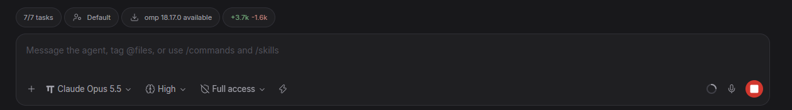

# Provider Updates

Keep the coding agent CLIs that Paseo runs up to date. When a newer version of an agent's provider is available, a pill shows above the composer. Select the pill to install the update on the daemon machine, then restart the session when you are ready.



## Install

```sh
paseo plugin add git:po-trottier/paseo-provider-updates
```

Paseo desktop and daemon 0.14.0 or later are required. The plugin has no setting and no build step.

## Usage

1. Open an agent. If its provider has an update, the pill shows `<Provider> <version> available`.
2. Select the pill and choose one item:
   - **Update** installs the new version. The open session continues with the old version until Paseo closes it after one hour idle. The next prompt then starts the new version.
   - **Update and restart now** installs the new version, then restarts this session at once.
3. After an update, an agent that still runs the old version shows **Restart for `<Provider> <version>`**. Select it to restart that session.

An update can run for 10 minutes. While it runs, the pill shows **Updating `<Provider>`…** on every agent of that provider. If you selected "restart now", you can cancel the restart from that pill. If the update fails, a toast shows the command output.

## Supported providers

The plugin does not use a fixed provider list. It checks every provider that is enabled and ready in Paseo Settings > Providers: built-in, ACP and custom. The way the provider was installed controls whether the plugin can update it:

| Install method | Example | Update command |
| --- | --- | --- |
| Global npm package | Codex, Copilot, OpenCode, Pi, most ACP agents | `npm install -g <pkg>@latest` |
| Homebrew formula or cask | `brew install opencode` | `brew upgrade [--cask] <name>` |
| Claude Code native installer | `~/.local/bin/claude` | `claude update` |
| Oh My Pi native installer | `%LOCALAPPDATA%\omp\omp.exe` | `omp update` |
| `npx`, `bunx`, `pnpx` or `uvx` launch | `npx -y @scope/agent@latest` | None. The runner downloads the package at each launch. |

Other install methods show no pill. Examples are a package in a project folder, a standalone binary with its own updater, `pipx`, and `bun` global installs. To see what the plugin found for each provider, run `paseo plugin logs provider-updates`. Each check writes a line such as:

```text
[provider-updates] checking: omp (...\omp.exe update), codex (npm install -g @openai/codex@latest), claude (...\claude.exe update)
```

## Restarts

An update never stops a session by itself. An open session keeps the old binary until Paseo closes its idle runtime. Paseo does this after one hour idle, and only when the provider reports no background work. Agents with no open session show no restart pill.

**Restart now** reopens the same conversation with the new binary. If the agent was running a turn, the turn stops, and the plugin sends `Resume working.` so the agent continues. Paseo sends the same text to agents that it resumes after a daemon restart.

If you select **Update and restart now**, the restart waits for the install. If the install fails, the plugin cancels the restart.

## How it works

- Version checks start when the first Paseo client connects, then run once an hour.
- For each provider, `paseo.providers.diagnostic()` gives the configured command and the resolved executable. The plugin finds the install method from that path:
  - npm: the executable, or the npm shim that starts it, is in `node_modules/<pkg>` under `npm root -g`. The latest version comes from the npm registry.
  - Homebrew: the executable is under `Cellar/<name>/` or `Caskroom/<name>/`. Both versions come from `brew info --json=v2`.
  - Claude Code: the latest version comes from the release channel in `autoUpdatesChannel` in `~/.claude/settings.json` (`latest` or `stable`).
  - Oh My Pi: both versions come from `omp update --check`.
- The plugin validates npm and Homebrew names before it puts them in a command. Native updaters run from the resolved path, not from `PATH`.
- A `before("agent.session_open")` hook records when each interactive session starts. A session that started before an install runs the old binary.
- The `agent.closed` and `agent.archived` events clear that record, because the next open uses the binary on disk.
- After an install, the plugin calls `paseo.providers.refresh()` so that new sessions read the new version.
- Paseo stops a plugin RPC after 30 seconds. The install and state RPCs are long polls that return within 20 seconds. The client calls them again until the work is done.
- All state is in daemon memory. A daemon restart starts every provider process again, so no session is old after it.

## Known limits

- **Restart now** also stops background work inside the provider process, such as OMP async jobs or Claude Code background shells.
- If `agents.idleRuntimeCleanup` is `false`, Paseo never closes idle sessions. Use **Restart now**.
- Paseo reopens open sessions before their next prompt when this plugin loads or reloads, because the plugin declares a session-open hook.
- Only updates installed through the pill mark sessions as old. An update from a terminal does not.
- Paseo 0.14 does not let a plugin read `agents.resumePrompt`, so the resume text is fixed.

## Development

Install from a local clone:

```text
npm install
npm run typecheck
paseo plugin add .
```

After a source change, run `paseo plugin reload provider-updates`. Do not restart Paseo. Then run `paseo plugin ls` and `paseo plugin logs provider-updates` to check the plugin status and its log.

Paseo contracts: [plugin reference](https://paseo.sh/docs/plugins/reference).
